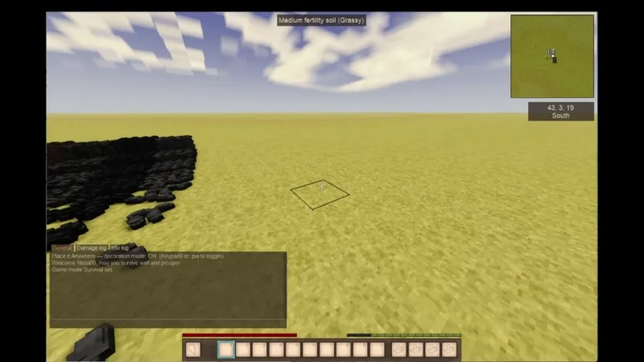

# Coal Piles

A lightweight Vintage Story mod that lets you neatly stack solid fuels in dense, deterministic 3D ground piles—holding up to **128 items per block** without conflicting with vanilla coal pile mechanics.

## Features
* **High-Capacity Storage:** Store up to **128 items** per block (8 layers of 16 chunks).
* **Fast Hold-to-Fill Stacking:** Hold down the interaction keys to rapidly stream items into a pile—fill a full 128-item pile in just over a second.
* **Vanilla-Friendly Controls:** Uses `Ctrl` to start and add to piles, keeping vanilla `Shift + Right-Click` coal piles completely intact.
* **5 Supported Fuels:**
  * Charcoal
  * Bituminous Coal (Black Coal)
  * Lignite (Brown Coal)
  * Coke
  * Contaminated Coal (1.22+)
* **Original 3D Models:** Uses the game's original 3D item models (scaled to `0.9x`) with their native textures, placed deterministically from the center outward with zero clipping and 90° per-layer rotation.
* **Dynamic Hitboxes:** Collision and selection boxes grow smoothly as each new layer is added.

## Controls

| Action | Input | Speed / Behavior |
| :--- | :--- | :--- |
| **Start a new pile** | `Ctrl + Right-Click` on solid ground | Places 1 item |
| **Add items (Single)** | `Ctrl + Right-Click` on matching pile | Tap for **1 item**, or **hold** to add continuously (~12 items/sec) |
| **Add items (Bulk)** | `Ctrl + Shift + Right-Click` on matching pile | Tap for **16 items** (1 layer), or **hold** to add 16 items every 0.15s |
| **Take 1 item** | `Right-Click` on pile | Removes 1 item |
| **Take 16 items** | `Shift + Right-Click` on pile | Removes 16 items (1 full layer) |

> **Note:** Bulk placement (`Ctrl + Shift + Right-Click`) and hold-to-fill only work on an **existing pile**. You must place at least **1 item** on the ground first with `Ctrl + Right-Click` so it does not conflict with vanilla's coal stacking mechanic.

*Breaking a pile drops all stored fuel items.*

## Known Issues
* Aiming at the **side** of an existing pile and pressing `Ctrl + Shift + Right-Click` may occasionally trigger the standard vanilla coal placement mechanic instead of adding to the pile. Aim at the **top** of the pile for reliable bulk stacking.

## Installation
1. Download the mod `.zip` file.
2. Place it into your Vintage Story `Mods` folder (usually `%appdata%\VintagestoryData\Mods`).
3. Launch the game and enable **Coal Piles** in the Mod Manager.

> **Warning:** If you disable or remove this mod from a world where it has already been used, you will **not be able to access** any items stored inside existing piles. Make sure to empty or break all your piles before disabling the mod.