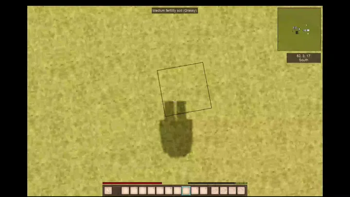
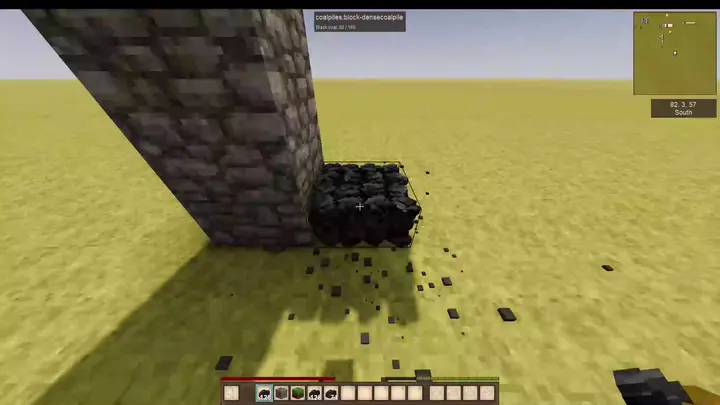
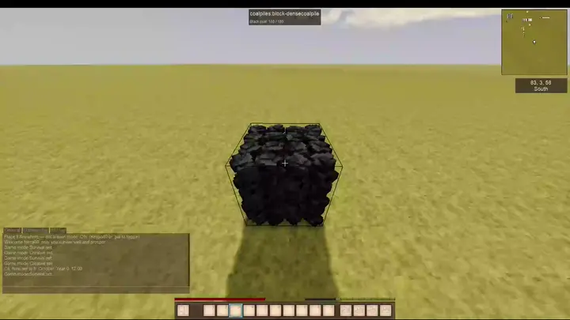

# Coal Piles

A lightweight Vintage Story mod that lets you neatly stack solid fuels in dense 3D ground piles—holding up to **160 items per block** and stacking infinitely upward without conflicting with vanilla coal pile mechanics.

## Features
- **High Capacity:** Store up to **160 items** per block (10 layers of 16 chunks) with full-block scaling hitboxes.
- **Infinite Vertical Stacking:** Keep adding to a full 160-item pile to automatically stack new piles upward.
- **6 Supported Fuels:** Charcoal, Bituminous Coal, Lignite, Anthracite, Coke, and Contaminated Coal (1.22+).
- **Fast Hold-to-Fill:** Hold the interaction keys to rapidly stream items into a pile.
- **Native 3D Visuals:** Uses each fuel's original 3D item model and textures, grounded and layered cleanly from the center outward.
- **Gravity Support:** Piles drop down when the block underneath is removed (preserving fuel type and count).
- **Vanilla-Safe Controls:** Uses `Ctrl` so vanilla `Shift + Right-Click` coal piles stay intact.

## Controls

| Action | Input | Behavior |
| :--- | :--- | :--- |
| **Start a pile** | `Ctrl + Right-Click` on ground | Places **1** item |
| **Start a pile (Bulk)** | `Ctrl + Shift + Right-Click` on ground | Places **16** items |
| **Add (Single)** | `Ctrl + Right-Click` on pile | Tap for **1**, or **hold** (~12/sec); stacks upward when full |
| **Add (Bulk)** | `Ctrl + Shift + Right-Click` on pile | Tap for **16**, or **hold** (16 / 0.15s); stacks upward when full |
| **Take** | `Right-Click` / `Shift + Right-Click` | Removes **1** or **16** items |

> Breaking a pile drops all stored fuel.

## Known Issues
- Aiming at the **side** of a pile while pressing `Ctrl + Shift + Right-Click` may trigger vanilla coal placement. Aim at the **top** of the pile for reliable bulk stacking.

## Installation
Drop the `.zip` file into your Vintage Story `Mods` folder and enable **Coal Piles** in the Mod Manager.

> **Warning:**
> 1. Empty or break all piles before removing this mod, or stored items will become inaccessible.
> 2. Tested on Windows only.